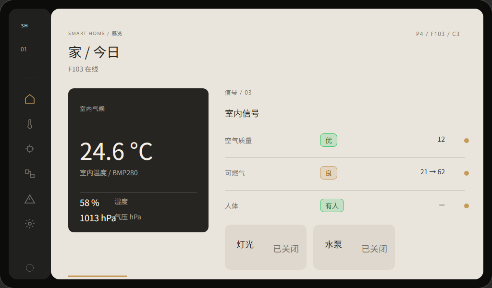
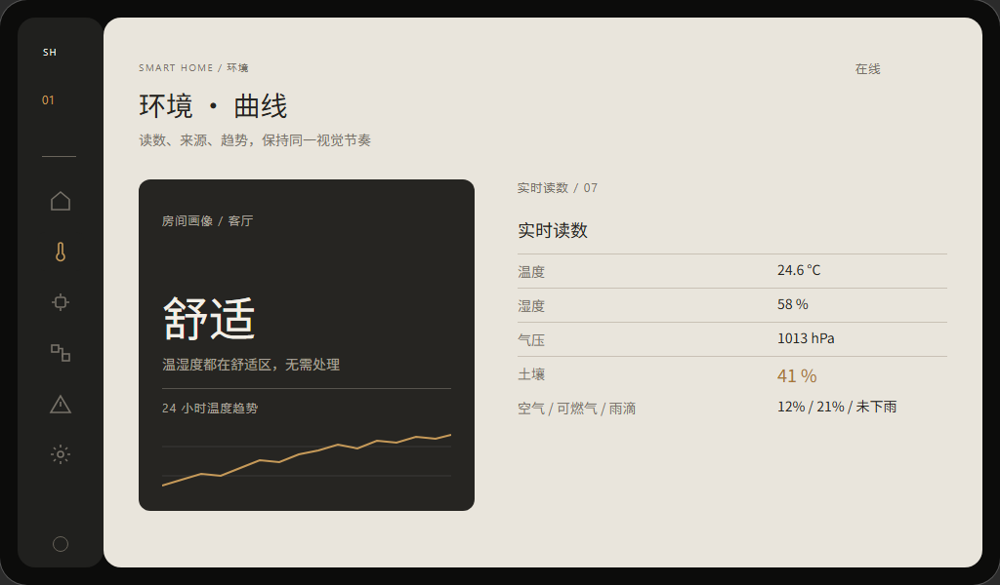

# 智能家居中控面板 · Smart Home Hub

> 装在墙上的 7 寸触摸中控面板：**本地优先、故障域隔离、能感知、能控制、能 OTA**。
> 不是"把传感器接上就算完成"的演示，而是一个按产品标准要求自己的嵌入式整机项目。


## 界面效果（HTML 交互原型）

以下截图由 [`ui/prototype/stage4-ui.html`](ui/prototype/stage4-ui.html) 在浏览器中渲染生成，用于展示界面设计；不是实机运行照片。





---

## 1. 一句话架构

**四芯片分层，按故障域切分，而不是按功能切分：**

```
  7" 1024×600 MIPI-DSI 触摸屏 ─┐
  OV5647 MIPI-CSI (800×640) ───┤ ESP32-P4 ──SDIO── ESP32-C6 (Wi-Fi 6 / BLE)
  microSD / 壁纸 / 字体 ───────┘   HMI + AI      esp_hosted 3.0.9 协处理器
                                     │
                                     │ UART 自定义二进制协议
                                     │ CRC16-CCITT + ACK/重传 + 去重 + TTL
                                     ▼
                              STM32F103C8T6
                              传感器 / 执行器 / 本地告警兜底 / IAP
                                     ▲
                                     │ BLE 控制/遥测 + MQTT 上行（已实现）
                              ESP32-C3 低功耗节点
```

**为什么执行器不直接挂在 P4 上**：GUI + 端侧 AI 的任务抖动不可控，而水泵、蜂鸣器这类负载必须可预测。P4 崩溃、重启或 OTA 时，F103 仍能独立维持失效安全态。这是**故障域隔离**，也是本项目与"一块板全干"的演示项目最大的区别。

---

## 2. 已实现能力（按验收状态）

| 模块 | 状态 | 证据 / 说明 |
|---|---|---|
| P4 六页中控 UI（LVGL 9） | ✅ 实机 | 触摸、页面栈、中文文本、SD 字体 + 内置 fallback |
| 待机壁纸播放器 | ✅ 实机 | JPEG 硬解，3 缓冲 × 1.19MB PSRAM，**28~29 fps 常播** |
| 双芯二进制协议 | ✅ 实机 | DMA + IDLE 收变长帧；3.6h / 13064 帧压测丢包 0、重传 0% |
| 设备抽象 + 影子状态 | ✅ 实机 | UI / 规则引擎 / MQTT 共用一套状态，新增设备零 UI 改动 |
| 本地规则引擎 | ✅ 实机 | 5 条默认规则（全部 opt-in），NVS 持久化，掉电保留 |
| 执行器联动 | ✅ 实机 | 本地点击 → 继电器 ACK 平均 **19.63ms**；泵 30s / 蜂鸣 5s 限时 |
| MQTT + Home Assistant | ✅ 实机 | 18 个实体自动发现（3 switch / 8 sensor / 7 binary_sensor） |
| 摄像头 + 端侧人脸检测 | ✅ 实机 | ESPDet PICO 416×416 INT8，单帧 **225~230ms** |
| P4 OTA（双分区 + 回滚 + 签名） | ✅ 实机 | OTA 镜像 ECDSA 验签 + SHA256；坏镜像自动回滚 |
| F103 IAP（经 P4 远程升级） | ✅ 实机 | bootloader @ 0x08000000，app @ 0x08002000，失败可恢复旧固件 |
| MQ-4 / MQ-135 标定 | ✅ 实机 | 社区口径 + Rs 峰值基线自跟踪；洁净空气 16~18 / 3~4 ppm |
| ESP32-C3 低功耗节点 | ✅ 实机（功耗待测） | BLE FFF0 遥测/控制 + FFF3 配网，Wi-Fi/MQTT 上行；BLE + Wi-Fi 共存 880s 零掉线，面板双节点显示与 12s 离线提示已验证；四模式电流未测，见 `docs/18` |
| 结构 / 电源 / 整机装配 | ❌ 未开始 | `hardware/` 仅 `.gitkeep` |
| 72h 压测 / core dump / W25Q64 环形日志 | ⏳ 部分 | 已做 3.6h 协议压测；其余列入阶段 8 剩余项 |

> 表中的"✅ 实机"均指在本机硬件上跑过并留有串口/抓包/日志证据，不是"代码写完"。

---

## 3. 实测数据

| 指标 | 实测值 | 测试条件 |
|---|---|---|
| 本地触摸 → 继电器吸合 | **18.87 ms**（min 16.47 / avg 19.63 / max 51.80，n=71） | P4 点击回调 → F103 ACK 回传 |
| 云端指令 → 状态回读 | **22~67 ms** | P4 收到 MQTT 指令 → 状态上报（PC 侧端到端抖动较大，见 `docs/17` §8） |
| 协议长稳 | **3.6 h / 13064 帧，丢包 0、重传 0%** | 10 Hz 上报 + 2s PING |
| MQTT 断线重连 | **≈1.1 s** | broker 停 10s 后重启 |
| HA 自动发现 | **18 个实体** | 无需手工配置 |
| 壁纸播放 | **28~29 fps** | 1024×600 JPEG 硬解，常播 10 分钟 0 次 MQTT 掉线 |
| 端侧人脸检测 | **225~230 ms/帧**（模型 mAP50-95 0.597） | ESPDet PICO 416×416 INT8 |
| MQ-4 洁净空气 | **16~18 ppm**，Rs/R0 ≈ 4.3 | 社区曲线 `1012.7×ratio^-2.786` |
| MQ-135 洁净空气 | **3~4 ppm**，Rs/R0 ≈ 3.6 | 社区曲线 `116.6×ratio^-2.769` |
| C3 节点共存 | **880 s：Wi-Fi 0 掉线、MQTT 无非预期断开、nfail=0** | BLE 长连接 + 1 Hz 遥测 + MQTT |
| C3 离线检测 | **12 s** | keepalive=12s，broker LWT 实测 |
| F103 固件体积 | **53,788 B / 56 KB（93.8%）** | Debug 构建，含 IAP 分区 |

---

## 4. 几个值得讲的设计决策

1. **C6 与 host 固件必须同版本**：`esp_hosted` host 3.0.9 ↔ CP 3.0.9（STREAM 模式）。跨大版本时 SDIO 会在 OTA 后停摆，表现为"Wi-Fi 永久掉线"，不是配置问题。版本已精确锁定，见 `docs/05` ADR-012。
2. **SD 卡与 C6 共用唯一 SDMMC 主机**：挂 SD 前必须等 hosted auto-init 就绪，否则启动时抢时钟会偶发 `failed to set clk` / `sdmmc_card_init 0x107`。
3. **壁纸不进内部 RAM**：3 个 1.19MB 帧缓冲全部放 PSRAM；同时把 lwIP/Wi-Fi 大块分配引导到 PSRAM（`CONFIG_SPIRAM_TRY_ALLOCATE_WIFI_LWIP`），给 SDIO mempool 留出内部 RAM。
4. **传感器用社区参数 + 基线自跟踪**：MQ 系列用 MQUnifiedsensor 的公开回归曲线（MQ-4 `R0=Rs(air)/4.4`、MQ-135 `R0=Rs(air)/3.6`），运行期以 Rs 历史峰值作为空气基线并缓慢衰减，吸收加热漂移；不再依赖"某一次洁净空气采样 + 24h 老化"。
5. **"指令已发出" ≠ "执行已确认"**：所有执行器状态以 F103 回读为准，HA 侧显示的不是乐观状态。

---

## 5. 快速开始

### P4 主控（ESP-IDF 6.1）

```bash
cd firmware/p4-hub
idf.py set-target esp32p4        # 首次
idf.py menuconfig                # 填 Wi-Fi SSID/密码（凭据不入库）
idf.py build
idf.py -p <PORT> flash monitor
```

### F103 控制节点（CubeMX + CMake）

```bash
cd firmware/f103-node
cmake --preset Debug
cmake --build --preset Debug
# ST-Link 烧录到 0x08002000（前 8KB 为 IAP bootloader）
```

> 首次上电预热 60s（Debug 快速模式）；Release 为 3 分钟预热 + 24h 老化参数。
> 传感器在 READY 前统一上报 `WARMUP`，不参与告警判定。

---

## 6. 仓库结构

```
smart-home-hub/
├── docs/                      ← 设计文档与决策记录（先文档后代码）
│   ├── 00-路线图.md
│   ├── 03-通信协议规范.md
│   ├── 05-决策记录-ADR.md      ← ADR-001~023
│   ├── 06-简历与面试映射.md
│   ├── 16-文档与实现差异.md    ← 改代码前先查事实基线
│   ├── 20-阶段十-复盘与演示脚本.md
│   └── journal/               ← 开发日志（卡点解决过程）
├── firmware/
│   ├── p4-hub/                ← ESP32-P4：UI / 协议 / MQTT / OTA / 视觉
│   ├── f103-node/             ← STM32F103：传感器 / 执行器 / IAP
│   └── c3-node/               ← ESP32-C3：BLE + MQTT 低功耗节点（功耗实测待补）
├── tools/                     ← 协议抓包、OTA 签名、字体/壁纸生成
└── hardware/                  ← 接线图 / 外壳 / 电流预算（规划中）
```

---

## 7. 文档导航

| 文档 | 内容 |
|---|---|
| [docs/00-路线图.md](docs/00-路线图.md) | 分阶段计划、验收标准、学习点 |
| [docs/02-系统架构.md](docs/02-系统架构.md) | 分层设计、任务划分、数据流 |
| [docs/03-通信协议规范.md](docs/03-通信协议规范.md) | 帧格式、可靠性机制、测试清单 |
| [docs/05-决策记录-ADR.md](docs/05-决策记录-ADR.md) | 每条架构决策的备选方案与代价 |
| [docs/16-文档与实现差异.md](docs/16-文档与实现差异.md) | 文档与代码的差异、事实基线 |
| [docs/17-MQTT与HA集成规范.md](docs/17-MQTT与HA集成规范.md) | Topic 规范、发现 JSON、仲裁策略 |

---

## 8. 已知边界（诚实清单）

- **72h 压测尚未执行**（当前最长协议压测 3.6h，壁纸常播 10min 无掉线）。
- **core dump 与 W25Q64 环形日志未接入**：分区已预留，配置与验证待完成。
- **ESP32-C3 节点已实现并验证 BLE 配网/遥测、Wi-Fi+MQTT 上行与离线提示**；但**四模式功耗与续航未实测**（缺积分式电流表），Deep-sleep 入口也未实现，简历中不写续航数字。
- **结构件、电源预算未开始**，简历与 README 不把它们算作已完成。
- **MQ 传感器是趋势/阈值器件，不是计量仪器**：社区曲线 + 分压比误差决定其绝对精度有限；洁净空气读数非 0 属正常本底。
- **F103 Flash 余量仅 ~3.5KB**（93.8%），后续功能需先评估裁剪或换 128KB 型号。
- **220V 市电绝不接入**：全项目只玩 12V/5V 直流。

---

## 9. 安全红线

1. 绝不用继电器切换 220V 市电；
2. 上电前先量电压，12V 进 5V 脚会烧板；
3. 水泵等功率负载不走面包板，只走端子/焊线；
4. 执行器默认失效安全态为断开，链路断开 >10s 强制关断。

---

### 主机测试结果

| 测试 | 结果 |
|---|---|
| `tests/f103-proto` | 通过 |
| `tests/jwp-reader` | 通过（支持无 ESP-IDF 的主机编译） |
| `tests/rule-engine` | 通过 |
| `tests/wifi-credentials` | 通过（长度及认证模式边界输入） |
| `tests/ota-manifest` | 通过（版本及数值畸形输入） |
| `tests/c3-credentials` | 通过（开放网络、WPA 密码长度及十六进制 PSK 边界） |


## 11. 许可

项目原创内容采用 [MIT License](LICENSE)；带有单文件 SPDX 标识的源码及 SDL2、CMSIS/HAL、cJSON 等第三方文件遵循各自的许可声明。
